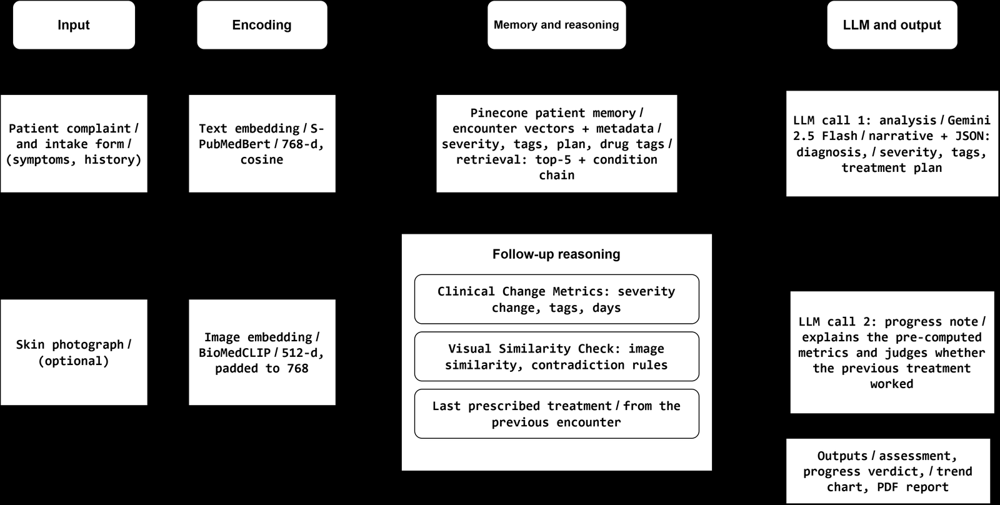
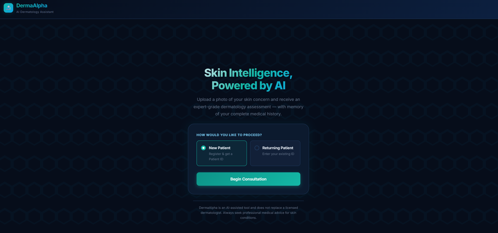
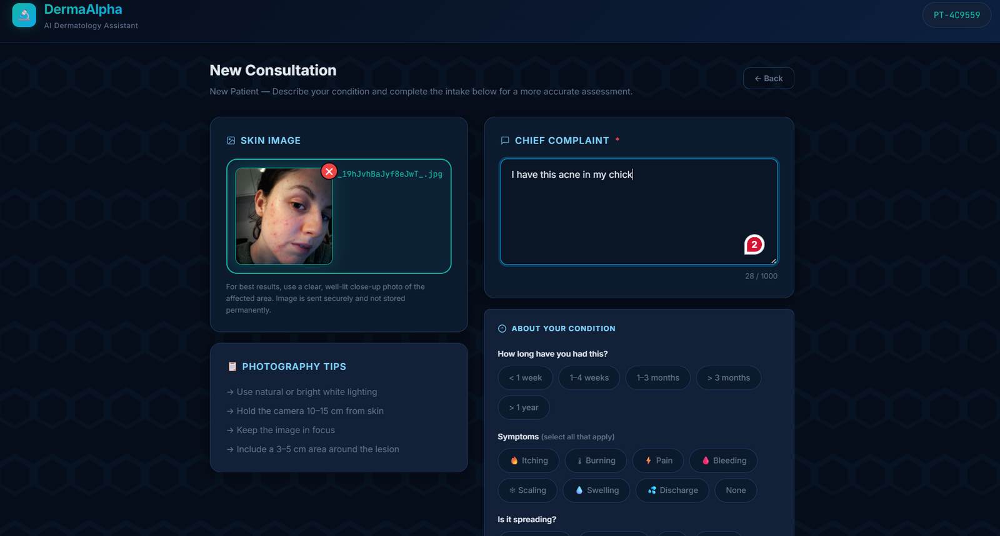
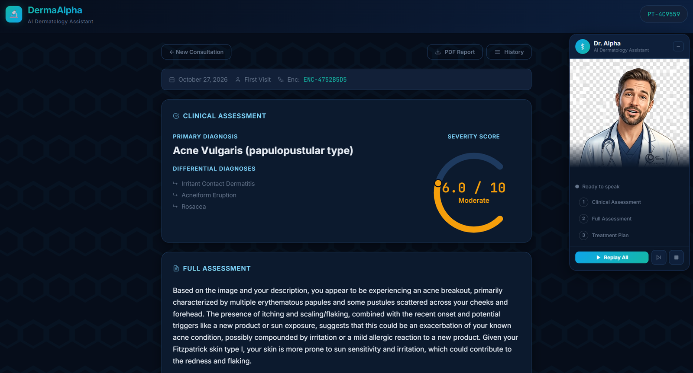
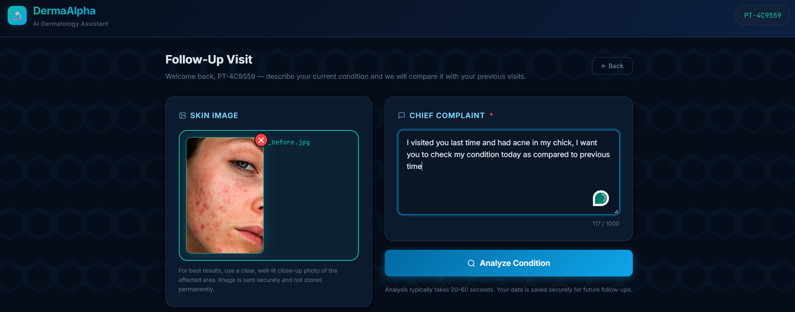
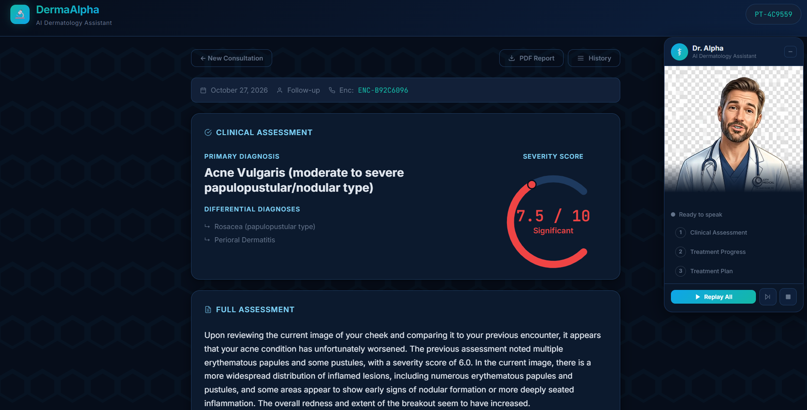
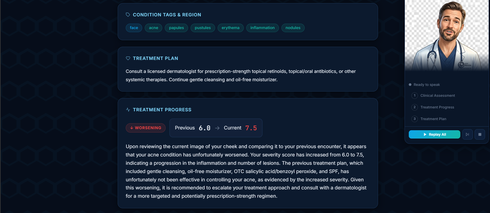
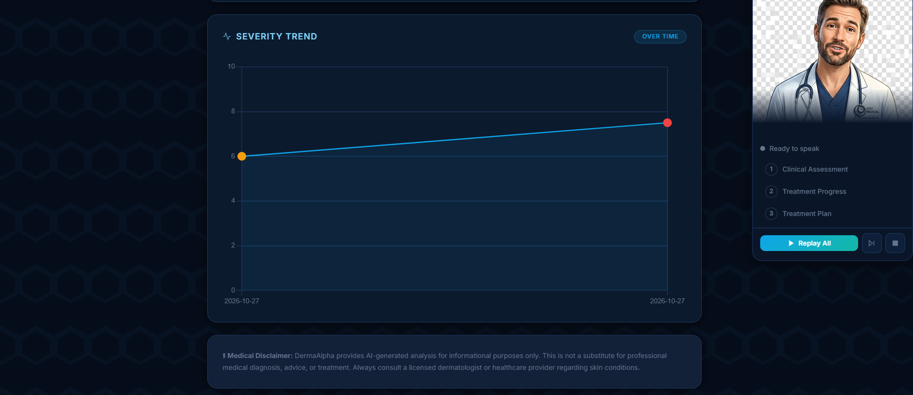

# DermaAlpha

**A prototype of a longitudinal, treatment-aware multimodal dermatology agent.**

Most dermatology AI looks at a single photo from a single visit. In chronic skin conditions such as acne, eczema, psoriasis and rosacea, the real question at a follow-up visit is *"is the treatment working?"*. DermaAlpha remembers each patient across visits. At every follow-up it compares the new photo and complaint with the patient's history and the last prescribed treatment, and judges whether the condition is improving, stable or worsening and whether the previous plan was effective.

It is the system-building companion to our scoping review:
> Sheikh A, Househ M. *Longitudinal treatment-aware multimodal AI for dermatology: a scoping review.* Stud Health Technol Inform. 2026;338:763-7. doi: [10.3233/SHTI260949](https://doi.org/10.3233/SHTI260949)

> ⚠️ **Research prototype, not a medical device.** Outputs are AI-generated decision support and have not been clinically validated. Always consult a licensed dermatologist.

---

## How it works



1. **Input:** the patient's complaint, a short intake form and an optional skin photo.
2. **Encoding:** the encounter text is embedded with a biomedical sentence model (S-PubMedBert-MS-MARCO, 768-d) and the photo with BioMedCLIP (512-d).
3. **Memory:** every encounter (diagnosis, severity, condition tags, treatment plan, drug tags, image vector) is stored in a Pinecone vector index keyed by patient ID.
4. **Follow-up reasoning** (returning patients only):
   - **Clinical change metrics:** severity change in points and percent, direction, and resolved, new or persistent conditions, computed deterministically.
   - **Visual similarity check:** BioMedCLIP cosine similarity between the two photos, with rules that flag contradictions between the image and the severity change.
   - **Last prescribed treatment:** injected into the prompt so the model must say whether it worked.
5. **LLM (Gemini 2.5 Flash):** call 1 produces the assessment (diagnosis, differentials, severity on a 1–10 rubric, treatment plan). Call 2 writes a progress note that explains the pre-computed metrics rather than inventing numbers.
6. **Output:** web report, treatment-progress verdict, severity trend chart and a downloadable PDF. A voice avatar ("Dr. Alpha", Edge TTS) can read the results aloud.

---

## Walkthrough: one patient, two visits

**Home:** start as a new patient or enter an existing patient ID.



**Visit 1, intake:** upload a photo and describe the complaint.



**Visit 1, result:** acne vulgaris (papulopustular), severity 6.0/10, with a treatment plan. The encounter is saved to memory.



**Visit 2, follow-up intake:** the returning patient only asks to compare with last time.



**Visit 2, result:** the system retrieves visit 1 and rates the acne at 7.5/10.



**Treatment progress:** worsening (6.0 → 7.5). The previous plan is judged ineffective and escalation to a dermatologist is recommended.



**Severity trend** across visits:



*Demo images come from the public [Kaggle Acne Dataset](https://www.kaggle.com/datasets/nayanchaure/acne-dataset). The two visits use photos of different people, so the walkthrough shows the workflow, not clinical accuracy.*

---

## Tech stack

| Part | Technology |
|---|---|
| Web app | Flask, vanilla JS single-page UI |
| LLM | Google Gemini 2.5 Flash (Ollama and MedGemma backends also supported) |
| Patient memory | Pinecone (serverless, cosine, 768-d) |
| Text embeddings | `pritamdeka/S-PubMedBert-MS-MARCO` |
| Image embeddings | Microsoft BioMedCLIP |
| Lesion hints | ViT skin-disease classifier (Hugging Face) |
| Voice | Edge TTS (Microsoft neural voices) |
| Reports | ReportLab PDF |

---

## Setup

Requirements: Python 3.10+, about 8 GB RAM, a [Gemini API key](https://aistudio.google.com/apikey) and a [Pinecone API key](https://app.pinecone.io). The models are downloaded from Hugging Face on first run (about 1–2 GB).

```bash
git clone https://github.com/Ah93/DermaAlpha.git
cd DermaAlpha
python3 -m venv venv
source venv/bin/activate          # Windows: venv\Scripts\activate
pip install -r requirements.txt

cp .env.example .env              # then fill in GEMINI_API_KEY and PINECONE_API_KEY
```

**Run (development):**
```bash
python app.py                     # http://localhost:5000
```

**Run (Linux server):**
```bash
gunicorn -w 1 -b 0.0.0.0:5000 --timeout 180 app:app
```
Use a single worker, because each worker loads its own copy of the models. The long timeout is needed because an analysis takes 20–60 seconds.

A command-line version is also available: `python main.py`.

---

## Project structure

```
app.py                  Flask routes: /api/check-patient, /api/analyze, /api/report, /api/history, /api/tts
config.py               Settings loaded from .env
main.py                 Command-line client
agent/
  medical_analyzer.py   LLM backends (Gemini / Ollama / HF) and response parsing
  memory_manager.py     Pinecone storage, retrieval, condition chains, drug tags
  prompts.py            Prompt templates and clinical change metrics
  visual_embedder.py    BioMedCLIP embeddings and the visual similarity check
  lesion_classifier.py  Auxiliary image classifier (hints only)
  derma_agent.py        CLI state machine
utils/
  report_generator.py   PDF reports
  image_utils.py        Image loading and resizing
templates/, static/     Web UI and avatar assets
```

---

## Limitations

- Shown on a single simulated patient; no clinical validation yet.
- Severity is an LLM-assigned score, not a validated clinical scale, and the thresholds are heuristics.
- "Treatment-aware" means conditioning on the previously recommended plan, not on logged medication use.
- Patient photos are sent to the Gemini API and encounter records are stored in Pinecone, so do not use real patient data without the appropriate approvals.

Next step: collect a longitudinal, treatment-annotated multi-visit dataset to validate the approach.

## Authors

Ahmed Sheikh, Mowafa Househ, Ahmed Moustafa El-Naggar, Zain Tariq. College of Science and Engineering, Hamad Bin Khalifa University, Doha, Qatar.
